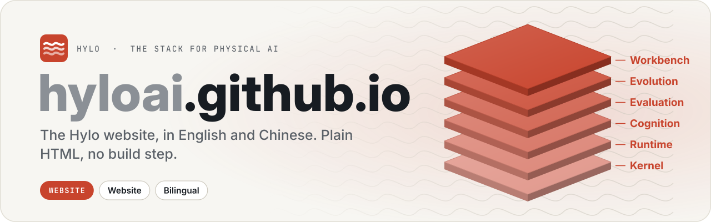

  <picture>
    <source media="(prefers-color-scheme: dark)" srcset=".github/assets/banner-dark.svg">
    
  </picture>

  
  
  

# Hylo AI website

The site at https://hyloai.github.io/ (bilingual: English, 中文). Plain HTML, no build step: edit `index.html`, push to
`main`, GitHub Pages serves it. Case-study images in `assets/` come from recorded runs (see hylo-docs).
Each of the three opening statements names the core concept it rests on (Agents, Worlds, Memory and skills, with
the same icon as the capability stack) and shows a Unitree G1 twin posed from a real sweeping episode (HIW-500,
CC BY 4.0) in a rendered room: the robot sees the room and acts, its contacts with the floor answer each stroke, and
layered strokes grow into a skill. Labels, rings and cards are HTML/SVG overlays, so both languages stay crisp.
Sources, frames and cameras are in `assets/thesis-stills.provenance.json`.

The homepage and docs share five core concepts: Physical RSI, Worlds, Agents, Memory and Skills. Physical RSI
connects the other four. The homepage pairs a circular five-step loop with a capability stack.
Inference Engine is its bottom layer, representing model serving and linking to the policy-serving guide.
Keep labels brief; hover and keyboard focus highlight related stages and capabilities. Preserve the `#loop` and `#stack` anchors. Studio,
deployment and architecture are supporting entry points. Keep homepage copy concise and aligned with the docs'
concept definitions. Keep English text, Chinese
`data-i18n` entries and metadata aligned with the [docs wording guide](https://github.com/HyloAI/hylo-docs/blob/main/docs/developer-guide/docs.md#shared-website-wording). Case studies must state their robot, observation conditions
and measured scope; link detailed results to the documentation. Build and verify the linked docs before publishing.

After changing Chinese text, regenerate the MiSans subsets with `tools/subset_fonts.py` and check both languages.

Apache License 2.0. Copyright 2026 Hylo AI.
