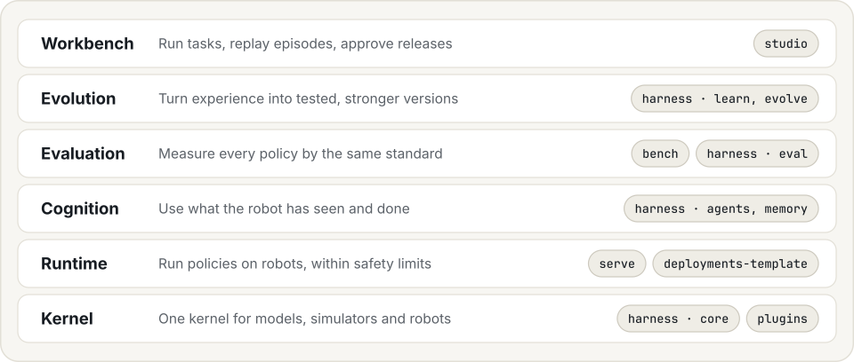

  <picture>
    <source media="(prefers-color-scheme: dark)" srcset=".github/assets/banner-dark.svg">
    
  </picture>

  
  
  

# Hylo AI website

The site at https://hyloai.github.io/ (bilingual: English, 中文). Plain HTML, no build step: edit `index.html`, push to
`main`, GitHub Pages serves it. Images in `assets/` come from recorded runs (see hylo-docs).

  <picture>
    <source media="(prefers-color-scheme: dark)" srcset=".github/assets/stack-dark.svg">
    
  </picture>

Apache License 2.0. Copyright 2026 Hylo AI.
